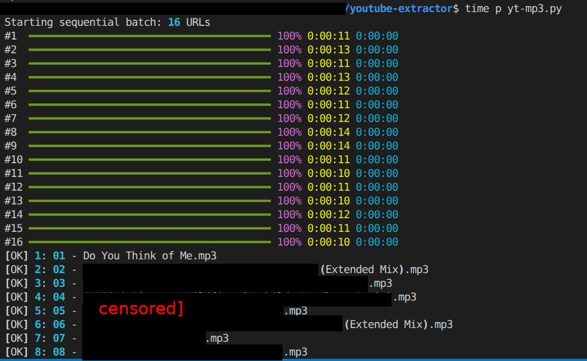

# YouTube-mixtapes
Generate MP3 “mixtapes” from a hand-picked list of YouTube URLs.

This project is a practical batch tool for:
- building personal mixtapes from selected YouTube videos
- backing up audio from your own channel (podcasts, songs, talks)
- exporting a curated listening set in a known order, such as for burdning to CD's and sorting by name

Output files are named in playlist order like:

`01 - Video Title.mp3`  
`02 - Video Title.mp3`  
...



---

## Features

- Sequential processing (stable and simple)
- Downloads best available audio with `yt-dlp`
- Converts to **320 kbps MP3** with `ffmpeg`
- Writes MP3 title metadata from YouTube title
- Safe filename sanitization (cross-platform)
- Optional duplicate-safe naming inside output folder (`(2)`, `(3)`, ...)
- Rich progress bars with:
  - percent
  - elapsed time
  - ETA
- Cookie workflow without browser extensions:
  - paste Chrome DevTools cookies JSON
  - script converts to Netscape `cookies.txt`
  - `yt-dlp` uses generated cookie file
- Safety guard: aborts if output folder already exists

---

## Why this exists

Sometimes you already have a list of URLs and just want a predictable, repeatable way to extract audio in that exact order.

This project is intentionally opinionated:
- simple config in one script
- no database
- no UI
- no concurrency complexity by default

---

## Requirements

- Python 3.11+
- `ffmpeg` available in PATH
- Python packages:
  - `yt-dlp`
  - `rich`
- Node.js available in shell (recommended for modern yt-dlp JS runtime needs)

---

## Setup

### 1) Clone repo

```bash
git clone https://github.com/<your-username>/YouTube-mixtapes.git
cd YouTube-mixtapes
```

### 2) Python environment

```bash
python3 -m venv .venv
source .venv/bin/activate
pip install -U pip
pip install yt-dlp rich
```

### 3) Node with nvm (recommended)

If you use `nvm`:

```bash
nvm install --lts
nvm use --lts
```

Optional: save default Node version for this repo using `.nvmrc`:

```bash
echo "lts/*" > .nvmrc
nvm use
```

Check:

```bash
node -v
```

### 4) Confirm ffmpeg

```bash
ffmpeg -version
```

---

## Cookie setup (no extension method)

This repo uses a manual cookie workflow:

1. Open Chrome and log in to YouTube.
2. Open `https://www.youtube.com`
3. Open DevTools (`F12`)
4. Go to Console and run:

```js
copy(JSON.stringify(await cookieStore.getAll(), null, 2))
```

5. Create `youtube_cookies.json` in the project folder.
6. Paste clipboard contents into that file and save.

At runtime, script converts this JSON into a Netscape cookie file (e.g. `youtube_cookies.txt`) and passes it to `yt-dlp`.

> Keep cookie files private. They contain session-authenticated data.

---

## Configuration

Open the script (e.g. `yt-mp3.py`) and edit:

- `OUTPUT_FOLDER`
- `URLS`
- `FFMPEG_THREADS`
- `MAX_RETRIES`
- `YOUTUBE_COOKIES_JSON`
- `GENERATED_COOKIES_TXT`

Example URL list:

```python
URLS = [
    "https://www.youtube.com/watch?v=[video url has id here]",
    ... [list other audio in order you want to extract it]
]
```

---

## Run

```bash
python yt-mp3.py
```

If output folder already exists, script exits intentionally to prevent accidental overwrite/mix-up.

---

## Output naming

Files are saved as:

`{index:02d} - {sanitized_title}.mp3`

Examples:

- `01 - My First Podcast.mp3`
- `02 - Studio Session.mp3`

Title metadata (`ID3 title`) is set to the original YouTube title (without index prefix).

---

## Troubleshooting

### HTTP 403 Forbidden

Try:
1. Refresh `youtube_cookies.json` from DevTools
2. Update yt-dlp:
   ```bash
   pip install -U yt-dlp
   ```
3. Ensure Node is active in shell:
   ```bash
   nvm use --lts
   node -v
   ```
4. Test a direct command:
   ```bash
   yt-dlp --cookies youtube_cookies.txt -f "bestaudio/best" -o "test.%(ext)s" "<VIDEO_URL>"
   ```

### “No supported JavaScript runtime could be found”

Enable Node in current shell:
```bash
nvm use --lts
```

### Cookie JSON parse errors

Make sure the JSON file is raw output from:
```js
copy(JSON.stringify(await cookieStore.getAll(), null, 2))
```
and not wrapped/edited.

---

## Legal / Responsible Use

Use this project responsibly and in compliance with:
- YouTube Terms of Service
- copyright law in your jurisdiction
- rights for content you own or are authorized to archive/use

This project is intended for personal archival and legitimate use cases.

---

## License

MIT License © krisdriver.com Kristopher Driver
